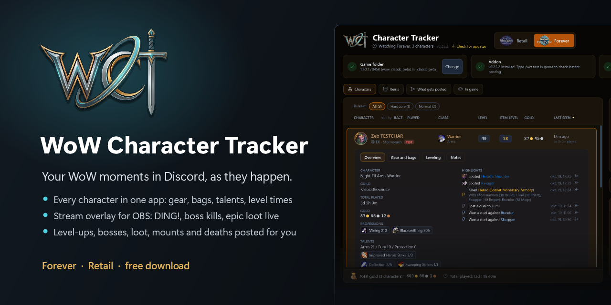
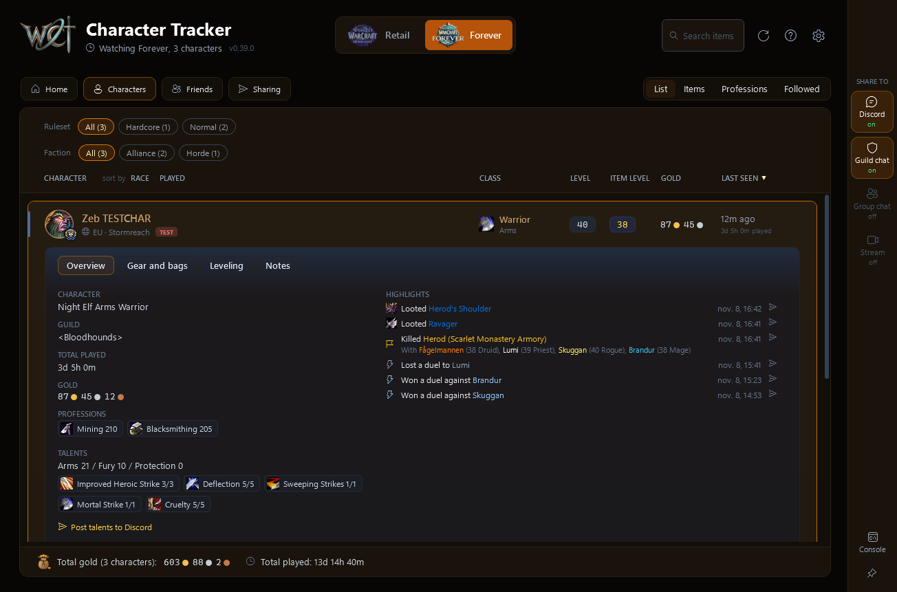
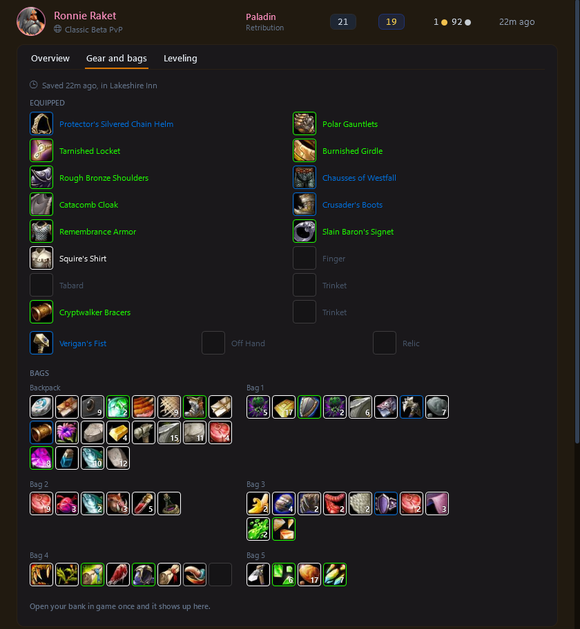
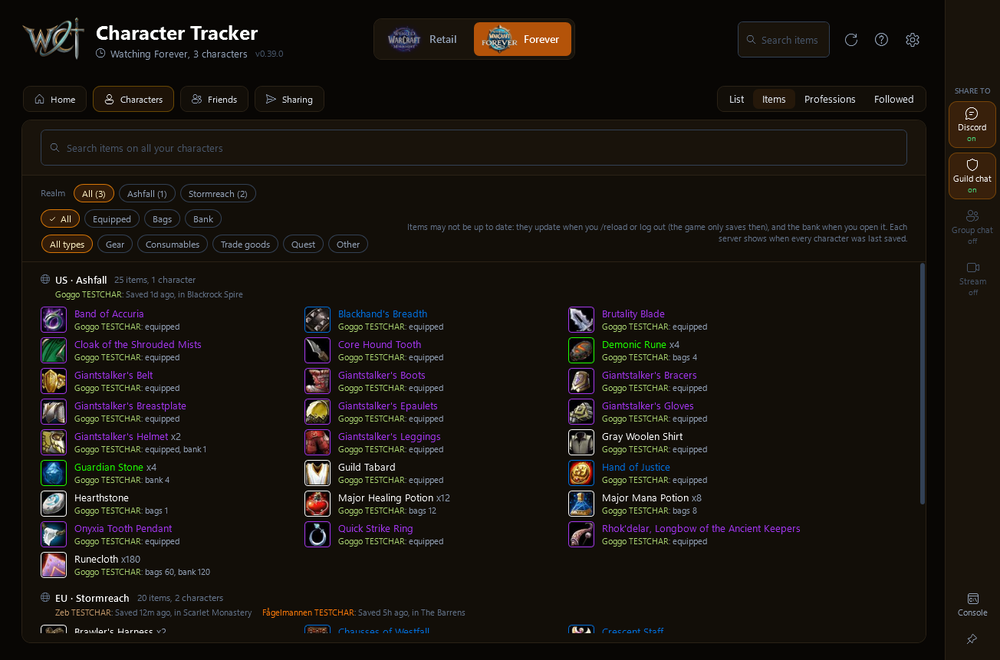
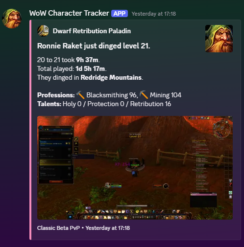
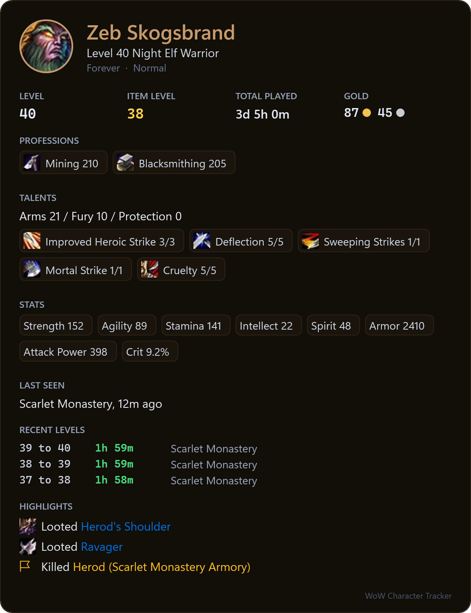
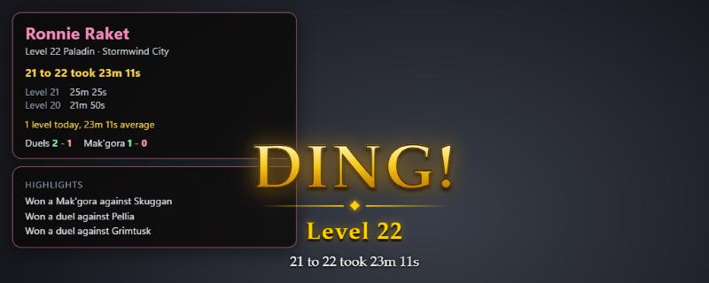

# WoW Character Tracker

**All your World of Warcraft characters in one place, and your best moments in Discord and on stream, if you want them there.**

Made for WoW Forever (Classic+), and works for Retail too. An addon that works on its own, plus a free Windows app that adds Discord, the stream overlay and the rest.

- **Every character at a glance**: level, item level, gold, talents, professions, gear, bags and bank, and how long every level took.
- **Find any item** across all your characters, with Wowhead tooltips, and see who can craft what.
- **Share with Battle.net friends** (optional): see the characters friends share with you, and pick what they get of yours.
- **Discord posts** (optional): level-ups, end boss kills (Mythic+ runs on Retail), epic loot, new mounts, hardcore deaths and more, the moment they happen, with an in-game screenshot if you like.
- **Stream overlay** (optional): your character, records and big **DING!** alerts in OBS or Streamlabs.
- **Stays out of the way**: waits in the tray, opens with WoW, updates itself, and uninstalls everything it added.

Nothing leaves your PC unless you set it up. See [Privacy](#privacy).

> **Still young, testers wanted.** It works day to day, but few people have run it so far, especially on Forever. If something looks off, or you have an idea, say so in [Discussions](https://github.com/JDybeck/wow-character-tracker/discussions) or [Issues](https://github.com/JDybeck/wow-character-tracker/issues).

## The addon alone, or with the app

**The addon on its own**, nothing else to install:

- **Group lines**: one line in party / raid chat for dings, end boss kills, epic loot, new mounts, wins, profession milestones and hardcore deaths. You pick which.
- **A window in game** (`/wct`): the character you're on with its level times and today's numbers, your characters on this account with gear and talents, and your notes.
- **Sharing with Battle.net friends**: their characters in your window, yours in theirs, and their spot on your map if they allow it.

**With the app on top** (Windows):

- **Discord posts**, with an in-game screenshot, and a box in game that offers to post what didn't go out.
- **Stream overlay** and **DING!** alerts in OBS or Streamlabs.
- **Every character on every WoW account**, every item in bags and bank searchable, and every profession side by side.
- **Keeps the addon up to date** for you.

## Install

1. Download `WoWCharacterTracker.exe` from the [latest release](https://github.com/JDybeck/wow-character-tracker/releases/latest) and run it. Nothing else to install. Windows may show a SmartScreen warning since the exe isn't signed yet: click **More info**, then **Run anyway**.
2. **Help me set it up** opens by itself: it finds your game folders, installs the addon with one click, takes a Discord webhook if you want your moments posted ([how to make one](docs/GUIDE.md#making-a-discord-webhook)), and asks how chatty it should be. Every step can be skipped; the **?** at the top brings it back.
3. In game, type `/wct test`. The app's console says instant posting works within a few seconds.

From then on the app waits in the tray and opens when you start WoW.

**Only the addon?** Copy the `addon/WoWCharacterTracker` folder from the latest release's source code into `Interface\AddOns` in your game folder. You can add the app later, it picks up everything the addon saved.

## A quick tour

**Home**: the character you're playing, how fast it's leveling, and your newest dings, kills, loot and mounts, each one a click from Discord.

**Characters**: click a character for its overview, gear and bags, leveling and notes. Gear shows set bonuses, effects and enchants; Equipment Manager sets show what's in your bags or bank.

**Items** (on Characters): everything your characters carry, per server. Search it, or show only what's worn, in bags or in the bank.

**Professions** (on Characters): every profession on every character, with skill and max, so you see who can craft what.

**Friends**: Battle.net friends with the addon can share their characters with you, gear and talents included, and you pick what they get of yours (gold and location only if you allow it). Nothing is shared until you say so.

**Sharing**: who hears about your moments. Pick Quiet, Normal or Everything, or choose per moment where it goes: Discord, a screenshot, group chat or the stream overlay. Posts come with the item's tooltip as a picture, or your in-game screenshot. Quick switches for each sit on the right edge of the window.

In Discord: a level-up with the screenshot the addon took in game, and a character card posted from the app.

 

**Stream overlay**: turn it on (Sharing, or the switch on the right edge), copy the address into OBS as a Browser source.

**Everything else**, every page and option, the in-game commands and how it works, is in the **[full guide](docs/GUIDE.md)**.

## Questions and ideas

Use [Discussions](https://github.com/JDybeck/wow-character-tracker/discussions) (the **Feedback** button in the app goes there) for questions, ideas and showing off your posts, and [Issues](https://github.com/JDybeck/wow-character-tracker/issues) for bugs. What changed in each version is in the [changelog](CHANGELOG.md).

Like it? Tips are welcome at [streamlabs.com/zebdryg/tip](https://streamlabs.com/zebdryg/tip) (there's a small **tip** link in the app's corner too). Never needed, always appreciated.

## Privacy

The app and addon only send data where you point them, plus a few lookups to show things nicely:

- **Your Discord webhooks**: the posts you've chosen to send, and a check that a webhook works when you add it.
- **Battle.net friends you share with**: the characters and details you picked for them, sent in game through Battle.net while you're both online. Nothing goes out until you allow a friend or share with one.
- **GitHub**: the update check (this repo's latest release).
- **Wowhead** (icons, item and talent names), **Raider.IO** (Retail character pictures, by realm and name) and **Warcraft Wiki** (the tab logos): public lookups, cached on your PC.

Nothing else leaves your PC. The stream overlay (when you turn it on) is a page only your own PC can open (localhost). Settings, webhooks and caches stay in `%LOCALAPPDATA%\WoWCharacterTracker`, and the addon only writes to the game's own SavedVariables and Screenshots folders.

## Code signing policy

Releases are built from this repository by [GitHub Actions](.github/workflows/release.yml), nothing is built by hand.

Free code signing is planned through [SignPath.io](https://about.signpath.io), with a certificate by the [SignPath Foundation](https://signpath.org). Until that's set up, the exe is unsigned.

- Committers and reviewers: [JDybeck](https://github.com/JDybeck)
- Approvers: [JDybeck](https://github.com/JDybeck)

## License

[GPL-3.0](LICENSE). You can use, change and share it; changed versions you share have to stay open under the same license. World of Warcraft and its art belong to Blizzard Entertainment; this project isn't made or endorsed by Blizzard.
