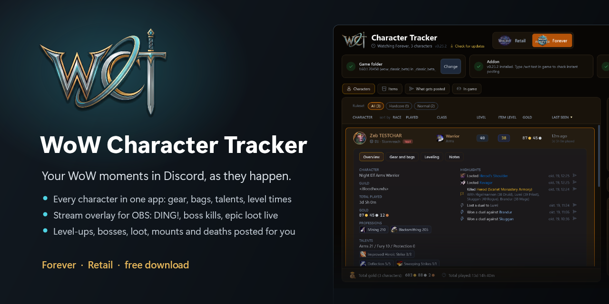
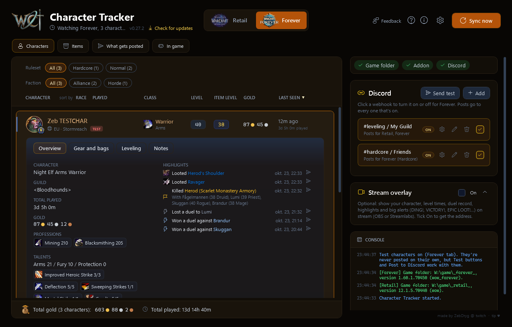
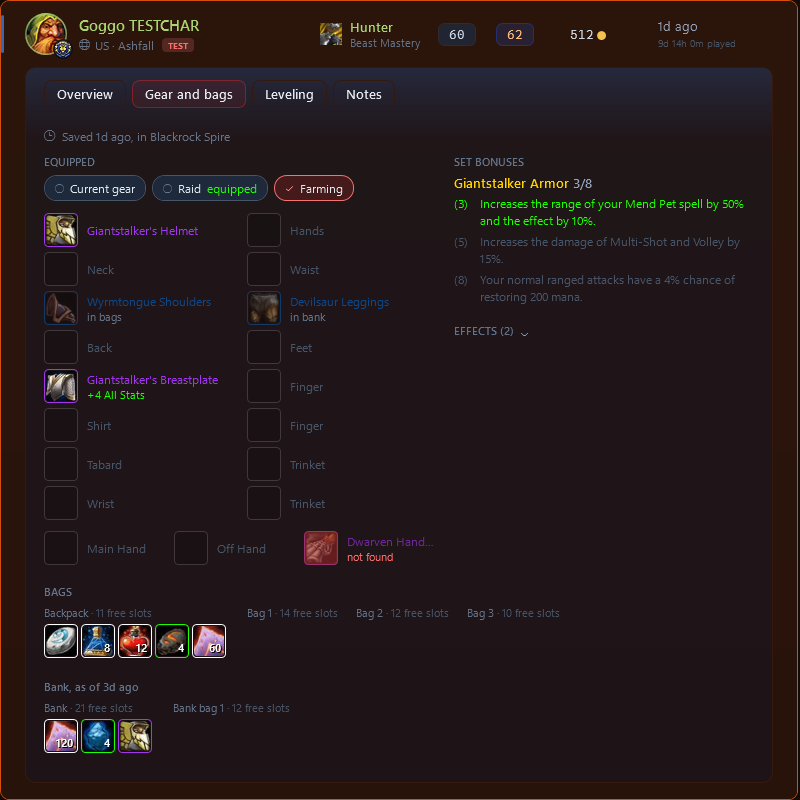
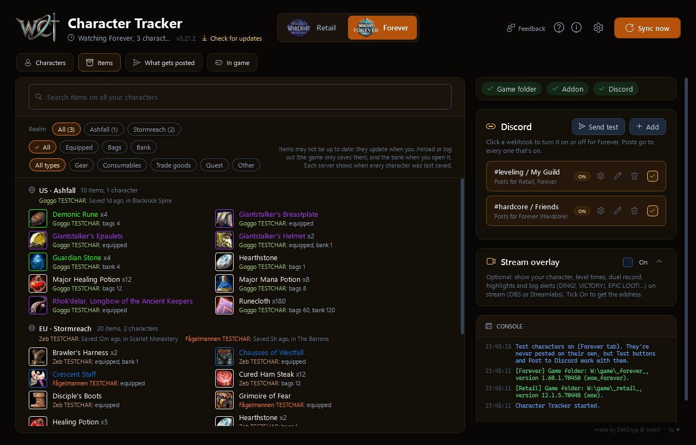
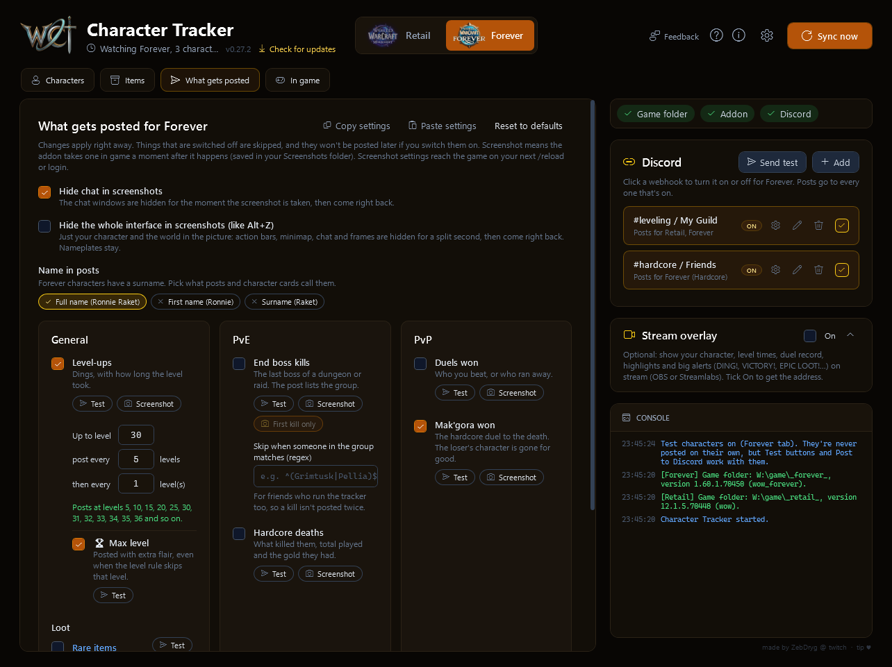
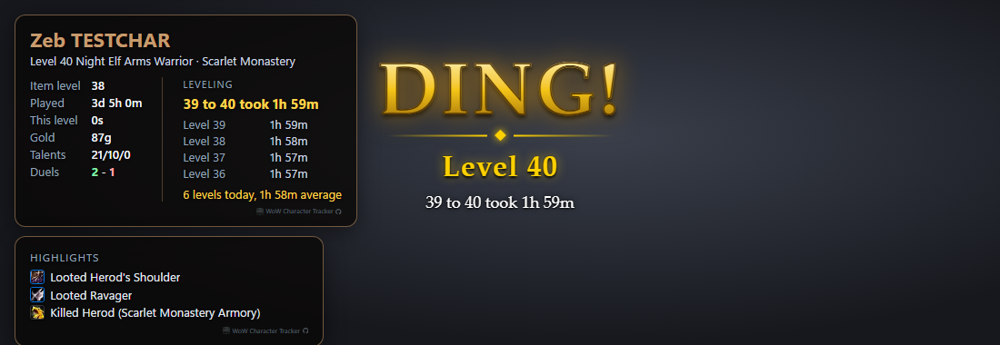

# WoW Character Tracker

**All your World of Warcraft characters in one place, and your best moments in Discord and on stream, if you want them there.**

Made for WoW Forever (Classic+), and works for Retail too. An addon in the game plus a small Windows app.

- **Every character at a glance**: level, item level, gold, talents, professions, gear, bags and bank, and how long every level took.
- **Find any item** across all your characters, with Wowhead tooltips.
- **Discord posts** (optional): level-ups, end boss kills, epic loot, new mounts, hardcore deaths and more, the moment they happen, with an in-game screenshot if you like.
- **Stream overlay** (optional): your character, records and big **DING!** alerts in OBS or Streamlabs.
- **Stays out of the way**: waits in the tray, opens with WoW, updates itself, and uninstalls everything it added.

Nothing leaves your PC unless you set it up. See [Privacy](#privacy).

> **Still young, testers wanted.** It works day to day, but few people have run it so far, especially on Forever, which launches on November 4, 2026. If something looks off, or you have an idea, say so in [Discussions](https://github.com/JDybeck/wow-character-tracker/discussions) or [Issues](https://github.com/JDybeck/wow-character-tracker/issues).

## Install

1. Download `WoWCharacterTracker.exe` from the [latest release](https://github.com/JDybeck/wow-character-tracker/releases/latest) and run it. Nothing else to install. Windows may show a SmartScreen warning since the exe isn't signed yet: click **More info**, then **Run anyway**.
2. Pick **Retail** or **Forever** at the top. The app finds your game folder by itself; click **Install** to add the addon to the game.
3. Optional: add a Discord webhook in the Discord panel ([how to make one](docs/GUIDE.md#making-a-discord-webhook)) so your moments get posted.
4. In game, type `/wct test`. The app's console says instant posting works within a few seconds.

From then on the app waits in the tray and opens when you start WoW.

## A quick tour

**Characters**: click a character for its overview, gear and bags, leveling and notes. Gear shows set bonuses, effects and enchants; Equipment Manager sets show what's in your bags or bank.

**Items**: everything your characters carry, per server. Search it, or show only what's worn, in bags or in the bank.

**What gets posted**: pick what goes to Discord, per game, with a Test button for each. Posts come with the item's tooltip as a picture, or your in-game screenshot.

**Stream overlay**: turn it on in its panel, copy the address into OBS as a Browser source.

**Everything else**, every page and option, the in-game commands and how it works, is in the **[full guide](docs/GUIDE.md)**.

## Questions and ideas

Use [Discussions](https://github.com/JDybeck/wow-character-tracker/discussions) (the **Feedback** button in the app goes there) for questions, ideas and showing off your posts, and [Issues](https://github.com/JDybeck/wow-character-tracker/issues) for bugs. What changed in each version is in the [changelog](CHANGELOG.md).

Like it? Tips are welcome at [streamlabs.com/zebdryg/tip](https://streamlabs.com/zebdryg/tip) (there's a small **tip** link in the app's corner too). Never needed, always appreciated.

## Privacy

The app and addon only send data where you point them, plus a few lookups to show things nicely:

- **Your Discord webhooks**: the posts you've chosen to send, and a check that a webhook works when you add it.
- **GitHub**: the update check (this repo's latest release).
- **Wowhead** (icons, item and talent names), **Raider.IO** (Retail character pictures, by realm and name) and **Warcraft Wiki** (the tab logos): public lookups, cached on your PC.

Nothing else leaves your PC. The stream overlay (when you turn it on) is a page only your own PC can open (localhost). Settings, webhooks and caches stay in `%LOCALAPPDATA%\WoWCharacterTracker`, and the addon only writes to the game's own SavedVariables and Screenshots folders.

## Code signing policy

Releases are built from this repository by [GitHub Actions](.github/workflows/release.yml), nothing is built by hand.

Free code signing is planned through [SignPath.io](https://about.signpath.io), with a certificate by the [SignPath Foundation](https://signpath.org). Until that's set up, the exe is unsigned.

- Committers and reviewers: [JDybeck](https://github.com/JDybeck)
- Approvers: [JDybeck](https://github.com/JDybeck)

## License

[GPL-3.0](LICENSE). You can use, change and share it; changed versions you share have to stay open under the same license. World of Warcraft and its art belong to Blizzard Entertainment; this project isn't made or endorsed by Blizzard.
