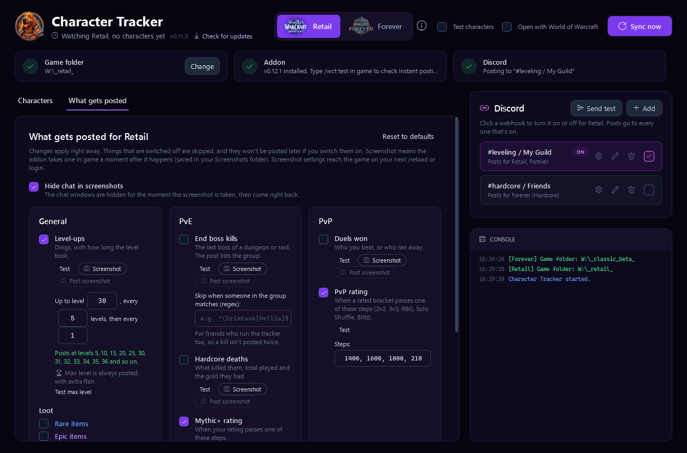
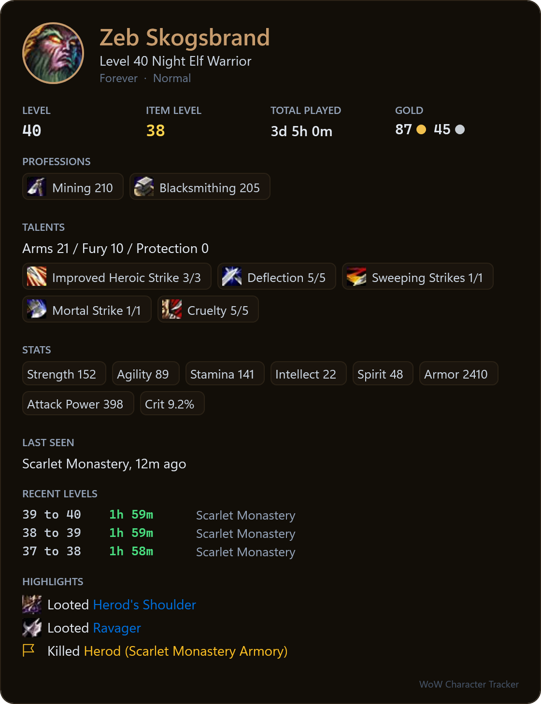
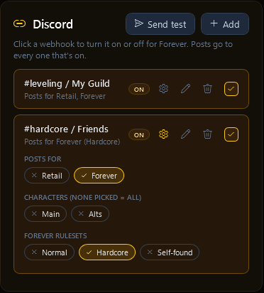
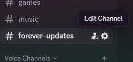
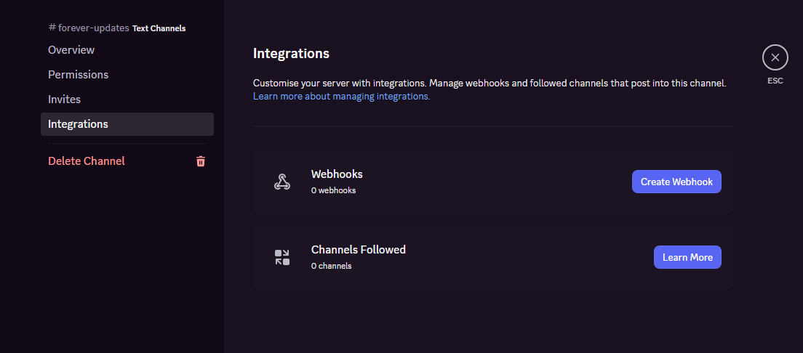

# wow-character-tracker

Posts your World of Warcraft moments to a Discord channel, the moment they happen: level-ups, end boss kills, rare and epic loot, new mounts, hardcore deaths, duels, Mak'gora wins and Mythic+ or PvP rating milestones. Posts can include a screenshot taken in game. The app also shows all your characters with their level, item level, gold, talents, stats, highlights and level history, and can post a character card to Discord.

Made with WoW Forever (Classic+) in mind, and works for Retail too. Each has its own tab and its own look.


A level-up post looks like this:

```
[Night Elf portrait]   Night Elf Warrior
                       Zeb Skogsbrand just dinged level 40.
                       39 to 40 took 1h 59m.
                       Total played: 3d 5h.
                       They dinged in Scarlet Monastery.

                       Professions: ⛏️ Mining 210, 🔨 Blacksmithing 205
                       Talents: Arms 21 / Fury 10 / Protection 0
                       [screenshot]
```

## Getting started

1. Download `WoWCharacterTracker.exe` from the [Releases page](https://github.com/JDybeck/wow-character-tracker/releases/latest). Nothing else to install. Windows might show a SmartScreen warning since the exe isn't signed, click **More info** and then **Run anyway**.

   Developers can build it themselves instead: run `build.cmd` (needs the [.NET 10 SDK](https://dotnet.microsoft.com/download)), it lands in `dist\`.
2. Double-click `WoWCharacterTracker.exe`. Pick **Retail** or **Forever** at the top. Three checks show what's set up for that game:
   - **Game folder**: found automatically, with the game version it found so you can see it picked the right one. Click **Change** to pick another folder. While Forever is in beta, its folder is `_classic_beta_`.
   - **Addon**: click **Install** once to put the addon in that game's AddOns folder. After that the app keeps it up to date on its own, including the interface number after patches.
   - **Discord**: paste a webhook link in the Discord panel (it explains how to get one). It's checked with Discord before saving. **Send test** shows you a sample post.
3. That's it. With **Open with World of Warcraft** on (the default), the app waits in the system tray and opens when you start WoW. When you close WoW it goes back to the tray, and it keeps tracking the whole time. Closing the window also sends it to the tray; right-click the tray icon to quit. Untick the option at the top to use it as a normal app instead.
4. In game, type `/wct test`. The console in the app should say instant posting works within a few seconds. The addon reminds you of `/wct help` when you log in, and the (i) icon at the top of the app lists the commands.

### What gets posted

Each game has a **What gets posted** page, in three columns:


- **General**
  - **Level-ups**: up to a level of your choice, post every few levels, then every level after that. Forever starts at every 5 levels up to 30, then every level. **Max level** has its own switch: on, it's posted with extra flair even when the level rule would skip it.
  - **Loot**: rare (blue) and epic (purple) items, separately. Legendary items are always posted, with extra flair. The post shows the item like its Wowhead tooltip, as a picture: icon, name in its quality color, item level, damage and speed, stats, green Equip lines and the sell price.
  - **New mounts**: bought from a vendor or learned.
- **PvE**
  - **End boss kills**: the last boss of a dungeon or raid, with the group. You can skip the post when someone in the group matches a regex, for friends who run the tracker too, so the same kill isn't posted twice.
  - **Hardcore deaths**: what killed the character, total played and the gold they had on them.
  - **Mythic+ rating** (Retail): when your rating climbs past one of your steps (2000, 2500, 3000, 3500 and 4000 by default). Going from 2800 to 3000 posts; going from 3000 to 3200 doesn't. Each step posts once per season.
- **PvP**
  - **Duels won**: who you beat, or who ran away.
  - **Mak'gora won** (Forever): the hardcore duel to the death.
  - **PvP rating** (Retail): the same for each rated bracket (2v2, 3v3, Rated Battlegrounds, Solo Shuffle, Blitz), with 1800, 2100, 2400 and 2700 as the default steps.

Every option has a **Test** button that posts a sample, using the selected character. Most have **Screenshot** (the addon takes one in game a moment after it happens) and **Post screenshot** (attach it to the Discord post). Screenshot settings reach the game on your next `/reload` or login; while the game runs, a banner at the top reminds you until it has loaded them. On Forever you can also pick the **Name in posts**: full name (Ronnie Raket), first name or surname.

Above the columns:

- **Hide chat in screenshots** and **Hide the whole interface in screenshots** (like Alt+Z): hidden for the split second of the shot, then right back.

**Copy settings** puts the whole page on your clipboard as a short code (it starts with `WCT1:`) to share with friends, and **Paste settings** applies a code someone shared to the game tab you're on. Webhooks and folders are never part of it.

Posts show the character's portrait as the sender picture, item and mount names link to Wowhead, and professions get an emoji.

The Retail tab has its own Midnight look:



### In game

The **In game** page has what the addon does in game besides posting:

- **Offer a reload on flight paths**: when you take a flight and your bags or gear changed since the last save, a small box in game offers a `/reload` (you keep flying), so the Items page gets up to date.
- **Remind me in chat to /reload**: one line in chat when your bags or gear changed since the last save, after the bank, mailbox, a vendor or the auction house, when you leave a dungeon, and every 30 minutes.
- **Advanced combat logging**: turns on the game's own Advanced Combat Logging setting (more detail in the combat log file, for log tools), set by the addon at your next login or `/reload`. Unticking turns it off again.

### The app

- **Characters**: every character you've logged in with the addon, with class, spec, level, item level, gold and when you last played. The bottom of the list shows the total gold and total played for the realm (Retail) or ruleset (Forever) you've filtered on. Hardcore characters are marked. Click one for its details, in three tabs:
  - **Overview**: guild, total played, gold, crests (Retail), professions, talents, stats, last zone and highlights. Boss kills say who was there, deaths what they cost. On Forever, talents are split into the class's three trees and every talent you picked is shown with its icon and rank. On Retail, **Open in Wowhead talent calculator** opens your build there.
  - **Gear and bags**: what the character wears, laid out like the character window, then its bags and its bank (as of the last time you opened it), with icons, quality colors and Wowhead tooltips. Click an item to open it on Wowhead.

    

  - **Leveling**: average, fastest and slowest level, a chart of your level times, how your item level and professions grew, your duel record, and the level history. On Forever also the played time left to max level at your recent pace. It counts that later levels need more XP, and that monsters give more XP too.
- **Items**: everything your characters carry (worn, bags and bank) in one list per server, with icons. Search by name to see who has what and where, or show only what's equipped, in bags or in the bank, or only one type (gear, consumables, trade goods, quest items). Hover an item for its tooltip, colored like in game. Each server shows when and where every character was last saved, since items only update on `/reload` or logout.
- **Tags**: make your own (like Main, Alts, Guild) and put them on characters. Webhooks can post only for some tags.
- **Post to Discord**: sends the character as a card picture, with icons and quality colors. The gear next to it picks what the card shows (item level, played, gold, crests, professions, talents, stats, guild, last seen, levels, highlights). **Remove from list** hides a character you don't play anymore; if you play it again, it comes back.

  

- **Filter**: chips above the list filter by realm on Retail and by ruleset (Hardcore, Self-found, Normal) on Forever.
- **Discord**: add as many webhooks as you like. Click one to turn it on or off for the game tab you're on; posts go to every webhook that's on. The gear opens its options: which games it posts for, on Forever which rulesets (so a hardcore channel only gets hardcore characters), and which character tags (none picked means every character). Click the pencil to rename a webhook, like "#leveling / My Guild". Hover a webhook to see its masked link.

  

- **Console**: what the app is doing, like posts sent and anything that needs your attention. Instant posts say how long they took to reach Discord, and where the time went.
- **Sync now**: reads the game's saved data again and posts anything new. The icon spins while it works, and the console says what it found.
- **Settings** (the gear at the top): **Open with World of Warcraft** (the app waits in the tray and opens when the game starts), **Hide the window when the game closes**, and **Test characters**, three made-up Forever characters (Zeb, Fågelmannen and Goggo) to try everything without playing. They're never posted on their own. **Track Retail** / **Track Forever** turn a game off if you only play the other one: the app then doesn't look at it at all (no addon installed there, its data isn't read), and its tab offers to turn it back on or remove the addon from it. **Colors for** the open game picks its theme: Midnight, Void arcane or Silvermoon for Retail, Classic gold, Forever wisp, Emerald Dream or Blackrock ember for Forever.
- **Updates**: the app checks for a new version when it starts and every few hours. **Check for updates** next to the version number checks right away. **Update now** downloads it and restarts, and **What's new** shows the notes from [CHANGELOG.md](CHANGELOG.md).
- **Uninstall** (Settings, at the bottom): lists everything the app and the addon put on your PC, with every path and its size, and you pick what goes: the app, the addon in each game, your character data in each game, and the app's settings and caches. **Keep my data** (the default) removes the app and the addon but keeps your characters and settings for later, **Remove everything** removes it all, **Only the app** leaves the addon running. Afterwards it shows what was removed, closes, and the app deletes itself a moment later. Close the game first, since it writes the addon's files again when it exits. Your screenshots, your webhooks in Discord and the game's Advanced combat logging setting stay either way.

### Making a Discord webhook

You can share a channel with friends (everyone adds the same webhook, or each their own webhook in that channel, and all your moments show up together), or make a channel just for yourself.

In Discord, hover the channel and click the gear (Edit Channel):



Then Integrations, Create Webhook (or Webhooks, New Webhook), and Copy Webhook URL. Paste it in the app with **Add** under Discord. You need the Manage Webhooks permission on the server. Posts use the webhook's name and the character's portrait as the sender.



Treat the link like a password: anyone with it can post in that channel. The app only ever shows it masked, and it's only stored on your PC.

### In-game commands

- `/wct` shows your last 10 level times for the character you're on.
- `/wct test` checks that instant posting reaches the app.
- `/wct live` turns instant posting on or off.
- `/wct help` lists these in game.
- `/wct popup` turns on a reload popup after a ding, if you'd rather not use instant posting.
- `/wct debug` saves what your client's talent, name and guild functions return, and the addon's recent `/played` requests and answers (for tracking down problems on new clients).

## How it works

WoW addons can't make network calls and only save their data on `/reload` or logout. The one file an addon can make the game write right away is a screenshot. So for each event, the addon shows a small black and white grid (about 320 x 28 px, with a "WoW Character Tracker" label next to it) in the top-left corner for a single frame, takes a screenshot and hides it again. The app reads the event from the grid within a second, posts it and deletes that screenshot. While that one screenshot is taken, the screenshot format is set to PNG (your own settings come right back) and the "Screen captured" message is hidden.


<sub>The grid enlarged 3x. The top row and left column alternate black and white so the app can measure the cell size, even if the picture is scaled.</sub>

Every event goes out this way (so the level history and highlights stay current), except loot that won't be posted, which waits for your next `/reload` or logout to keep the corner flicker down. There's also one check-in about 15 seconds after you log in, so your character's row in the app updates right away. In-game screenshots are only taken for events that get posted. Nothing is posted twice.

Level times: the addon stores your total played at the start of each level, and a finished level's time is the difference. It times the level right at the ding from the played time it already knows (the played time at your last logout, plus the time since you logged in), so it doesn't wait on the game. `RequestTimePlayed()` answers then make the next level's start exact. Level 1 to 2 always counts from 0. If the addon came in mid-level, that level is still logged, with its time shown as "?".

## Ideas and plans

Not built yet, roughly in order:

- **Forever character pictures**: Retail characters already show their real render; Forever will once it has an armory.
- **Forever talent link with your build**: the Wowhead link opens the right class, but doesn't fill in your points yet.
- **Hardcore death killer**: name what killed the character again (newer clients keep the combat log from addons).
- **Minimap button** for the addon, with the commands and a test button.
- **Per-character posting rules**, on top of each game's What gets posted.
- **Warband bank** (Retail), maybe through Baganator's saved data.

## Notes and limits

- Talents: Forever shows points in its three trees plus each pick. Retail shows points in the class, spec and hero trees.
- Professions and end bosses are matched by English name, so a non-English client won't show them.
- Bags and gear reach the app on `/reload` or logout (they're too much for the live channel). The bank only updates when you open it in game.
- Rating milestones start counting from the first time the addon sees your rating, so ratings you already had aren't posted.
- Retail portraits are the character's own render, found through Raider.IO (after the next login with the updated addon). Forever characters show their own portrait in the app: the addon puts it next to the data grid in the check-in shot after you log in, and the app cuts it out. Discord needs a web address for pictures, so posts use the race portrait from Wowhead's icon CDN (or the class icon) instead.
- Screenshots go out at full size first (boosted servers allow bigger uploads). If Discord says one is too big, a smaller JPEG copy is sent instead, and only if that's still too big does the post go out without it.
- On the first run, events already saved are marked as posted so the channel isn't flooded. Start the app with `--backfill` to post them instead.
- Settings and webhooks are saved in `%LOCALAPPDATA%\WoWCharacterTracker\config.json` and survive updates.

## Questions and ideas

Use [Discussions](https://github.com/JDybeck/wow-character-tracker/discussions) (the **Feedback** button in the app goes there) for questions, ideas and showing off your posts, and [Issues](https://github.com/JDybeck/wow-character-tracker/issues) for bugs.

## Privacy

The app and addon only send data where you point them, plus a few lookups to show things nicely:

- **Your Discord webhooks**: the posts you've chosen to send, and a check that a webhook works when you add it.
- **GitHub**: the update check (this repo's latest release).
- **Wowhead** (icons, item and talent names), **Raider.IO** (Retail character pictures, by realm and name) and **Warcraft Wiki** (the tab logos): public lookups, cached on your PC.

Nothing else leaves your PC. Settings, webhooks and caches stay in `%LOCALAPPDATA%\WoWCharacterTracker`, and the addon only writes to the game's own SavedVariables and Screenshots folders.

## Code signing policy

Releases are built from this repository by [GitHub Actions](.github/workflows/release.yml), nothing is built by hand.

Free code signing is planned through [SignPath.io](https://about.signpath.io), with a certificate by the [SignPath Foundation](https://signpath.org). Until that's set up, the exe is unsigned.

- Committers and reviewers: [JDybeck](https://github.com/JDybeck)
- Approvers: [JDybeck](https://github.com/JDybeck)

## License

[GPL-3.0](LICENSE). You can use, change and share it; changed versions you share have to stay open under the same license. World of Warcraft and its art belong to Blizzard Entertainment; this project isn't made or endorsed by Blizzard.
