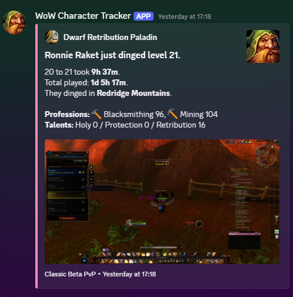
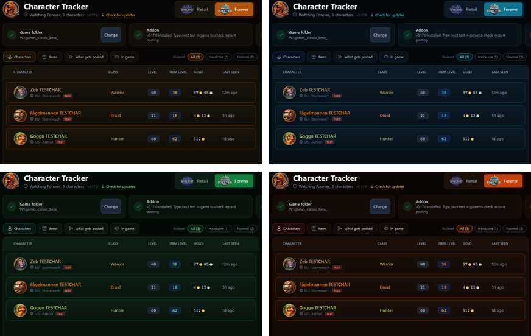
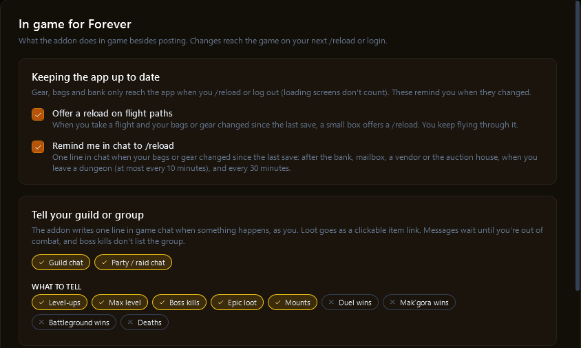
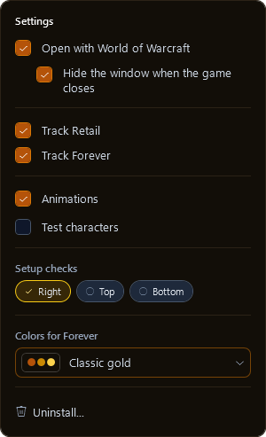
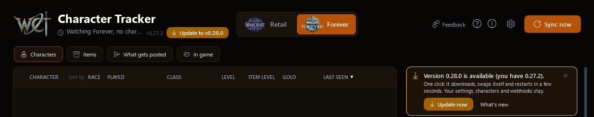
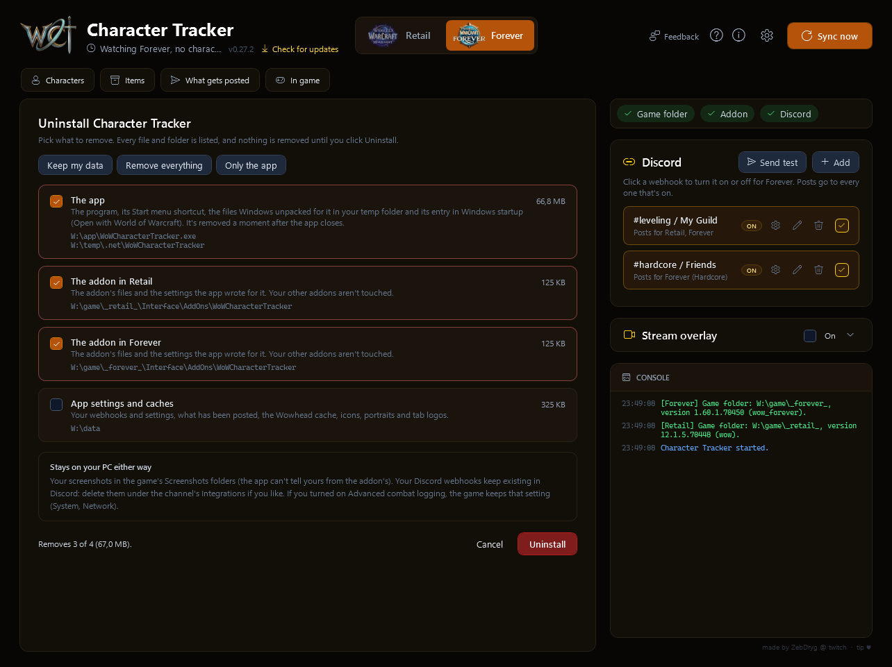
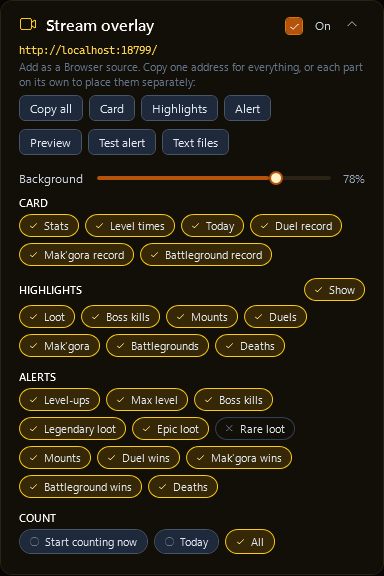
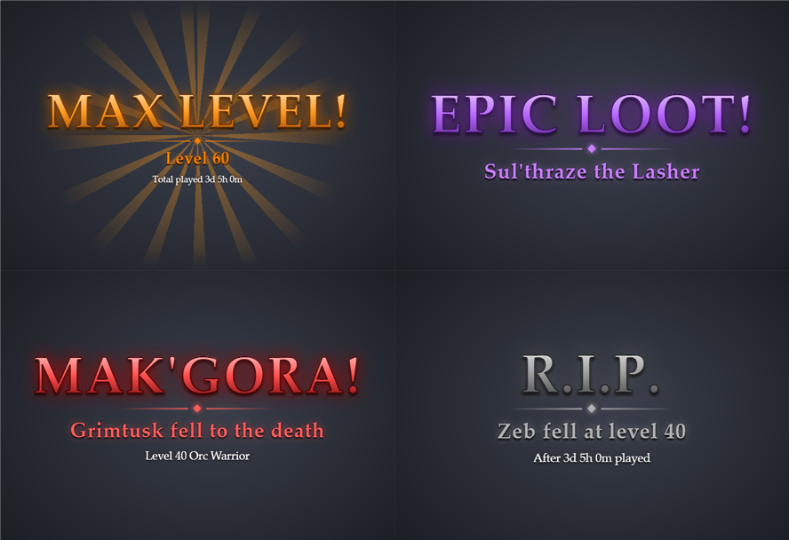

# WoW Character Tracker: the full guide

Everything the app and the addon do, page by page. New here? The [README](../README.md) has the short version: what it is and how to get going.

## Contents

- [Getting started](#getting-started)
- [What gets posted](#what-gets-posted)
- [In game](#in-game)
- [The app](#the-app)
- [Streaming](#streaming)
- [Making a Discord webhook](#making-a-discord-webhook)
- [In-game commands](#in-game-commands)
- [How it works](#how-it-works)
- [Ideas and plans](#ideas-and-plans)
- [Notes and limits](#notes-and-limits)

## Getting started

1. Download `WoWCharacterTracker.exe` (about 56 MB) from the [Releases page](https://github.com/JDybeck/wow-character-tracker/releases/latest). Nothing else to install. On its first start it adds itself to your Start menu, so you can find it later by typing "WoW Character Tracker" in Windows search. Windows might show a SmartScreen warning since the exe isn't signed, click **More info** and then **Run anyway**.

   Developers can build it themselves instead: run `build.cmd` (needs the [.NET 10 SDK](https://dotnet.microsoft.com/download)), it lands in `dist\`.
2. Double-click `WoWCharacterTracker.exe`. Pick **Retail** or **Forever** at the top. Three checks show what's set up for that game:
   - **Game folder**: found automatically, with the game version it found so you can see it picked the right one. Click **Change** to pick another folder. Forever's folder is `_forever_` (the beta's `_classic_beta_` still works; once `_forever_` is installed next to it, the app moves over by itself).
   - **Addon**: click **Install** once to put the addon in that game's AddOns folder. After that the app keeps it up to date on its own, including the interface number after patches.
   - **Discord**: paste a webhook link in the Discord panel (it explains how to get one). It's checked with Discord before saving. **Send test** shows you a sample post.
3. That's it. With **Open with World of Warcraft** on (the default), the app waits in the system tray and opens when you start WoW. When you close WoW it goes back to the tray, and it keeps tracking the whole time. Closing the window also sends it to the tray; right-click the tray icon to quit. Untick the option at the top to use it as a normal app instead.
4. In game, type `/wct test`. The console in the app should say instant posting works within a few seconds. The addon reminds you of `/wct help` when you log in, and the (i) icon at the top of the app lists the commands.

## What gets posted

Each game has a **What gets posted** page, in three columns:

- **General**
  - **Level-ups**: up to a level of your choice, post every few levels, then every level after that. Forever starts at every 5 levels up to 30, then every level. **Max level** has its own switch: on, it's posted with extra flair even when the level rule would skip it.
  - **Loot**: rare (blue) and epic (purple) items, separately. Legendary items are always posted, with extra flair. **Rares: Bind on Equip only** (on by default) posts just the rares that bind when equipped, the world drops people farm and trade, and skips the dungeon blues that bind when picked up. Every rare still shows in the app's highlights. The post shows the item like its Wowhead tooltip, as a picture: icon, name in its quality color, item level, damage and speed, stats, green Equip lines and the sell price.
  - **New mounts**: bought from a vendor or learned.
  - **Profession milestones**: when a main profession's skill climbs past one of your steps (on Forever 75, 150, 225 and 300 by default, the Classic rank caps; on Retail 100, the max of each expansion's skill). Going from 140 to 151 Mining posts "reached 150 Mining"; a jump past several steps posts the highest one. Each step posts once per character and profession.
- **PvE**
  - **Mythic+ runs** (Retail, in place of end boss kills): a finished key, with the dungeon, the time, how far the key goes up (or that it went over time), your new Mythic+ rating and the group. Set the lowest key level that gets a post (**From key level**, 10 by default; 2 posts every key) and tick **Timed only** to skip keys that went over the timer. Every run still shows in the app's highlights.
  - **End boss kills** (Forever): the last boss of a dungeon or raid, with the group. On by default, only each character's first kill of a boss is posted (turn off **First kill only** to post every kill). You can skip the post when someone in the group matches a regex, for friends who run the tracker too, so the same kill isn't posted twice.
  - **Hardcore deaths**: what killed the character, total played and the gold they had on them.
  - **Mythic+ rating** (Retail): when your rating climbs past one of your steps (2000, 2500, 3000, 3500 and 4000 by default). Going from 2800 to 3000 posts; going from 3000 to 3200 doesn't. Each step posts once per season.
- **PvP**
  - **Duels won**: who you beat, or who ran away.
  - **Mak'gora won** (Forever): the hardcore duel to the death.
  - **Battleground wins**: which battleground your team won. Off by default. Losses only show in the app.
  - **PvP rating** (Retail): the same for each rated bracket (2v2, 3v3, Rated Battlegrounds, Solo Shuffle, Blitz), with 1800, 2100, 2400 and 2700 as the default steps.

Every option has a **Test** button that posts a sample, using the selected character. Most have **Screenshot** (the addon takes one in game a moment after it happens) and **Post screenshot** (attach it to the Discord post). Screenshot settings reach the game on your next `/reload` or login; while the game runs, a banner at the top reminds you until it has loaded them. On Forever you can also pick the **Name in posts**: full name (Ronnie Raket), first name or surname.

Above the columns:

- **Hide chat in screenshots** and **Hide the whole interface in screenshots** (like Alt+Z): hidden for the split second of the shot, then right back.

**Copy settings** puts the whole page on your clipboard as a short code (it starts with `WCT1:`) to share with friends, and **Paste settings** applies a code someone shared to the game tab you're on. Webhooks and folders are never part of it.

Posts are sent as Character Tracker, with its logo, so they're easy to spot; the character's own picture is in the post (the same one the app shows). Item and mount names link to Wowhead, and professions get an emoji.

A level-up post, with the screenshot the addon took in game:

Each game has its own look, and under Settings you can pick a color theme per game: Midnight, Void arcane or Silvermoon made for Retail, Classic gold, Forever wisp, Emerald Dream or Blackrock ember made for Forever, and faction and city looks (Alliance, Horde, Darnassus, Undercity, Icecrown). Every look can be used in either game. Here's Forever in its own four:

## In game

The **In game** page has what the addon does in game besides posting:

- **Offer a reload on flight paths**: when you take a flight and your bags or gear changed since the last save, a small box in game offers a `/reload` (you keep flying), so the Items page gets up to date.
- **Remind me in chat to /reload**: one line in chat when your bags or gear changed since the last save, after the bank, mailbox, a vendor or the auction house, when you leave a dungeon, and every 30 minutes.
- **Tell your guild or group**: the addon writes one line in guild chat and/or party (or raid) chat, as you, when something happens: level-ups ("Ding! Level 23. 22 to 23 took 41m 12s."), max level, end boss kills (Mythic+ runs on Retail, from the same lowest key level as the posts: "Timed +12 Ara-Kara, City of Echoes (+2)!"), epic and legendary loot as a clickable item link, new mounts, duel, Mak'gora and battleground wins, profession milestones ("Reached 150 Mining!"), rating steps (Retail) and hardcore deaths. Pick which. Messages wait until you're out of combat, and boss kills don't list the group. Off until you tick Guild chat or Party / raid chat.
- **Instant posting**: the corner the small data grid is flashed in (top left, top right, bottom left or bottom right), and whether its small label shows.
- **Saved history**: every level-up, boss kill, mount and death is always kept. Loot, duels, battlegrounds and Mythic+ runs pile up fast, so by default the addon keeps the newest 300 of each per character, which keeps `/reload`, logout and the app quick. Tick **Keep everything** to never trim anything (duel and battleground records then count every fight since the start).
- **Advanced combat logging**: turns on the game's own Advanced Combat Logging setting (more detail in the combat log file, for log tools), set by the addon at your next login or `/reload`. Unticking turns it off again.
- **Character notes in game**: `/wct note` shows this character's note in a box on screen, the same note as the app's Notes tab. Click **Edit** in the box to change it right there. The newest edit wins: the game takes the app's changes on `/reload`, and the app takes the game's when you `/reload` or log out. Drag the box where you want it, then **Lock** it (`/wct note lock`) so your clicks go through to the game. `/wct note unlock` moves it again, and `/wct note reset` puts it back in the middle of the screen. Its buttons only show while your mouse is over the box, unless you turn that off.
- **Addon options**: Esc, Options, AddOns, WoW Character Tracker (or `/wct options`). Show, lock or reset the note box, set how see-through its background is, and turn instant posting and the reload popup on or off. What the app decides (what gets posted, screenshots, announcements, reminders, saved history) is listed there too, read-only.

## The app

- **Characters**: every character you've logged in with the addon, with class, spec and its icon (or a role icon, tank, healer, or melee, ranged or caster damage, until the spec is known), level, item level, gold and when you last played. Click a column title to sort by it, again to flip it; race, played time and rating (Retail) sort from next to CHARACTER. The order is remembered per game. The bottom of the list shows the total gold and total played for the realm (Retail) or ruleset (Forever) you've filtered on. Hardcore characters are marked. Click one for its details, in four tabs:
  - **Overview**: guild, total played, gold, crests and your Mythic Keystone (Retail), professions, talents, stats (each with its icon), last zone (with an icon for what kind of place it is: dungeon, raid, battleground, city, town or the open world) and highlights. Boss kills and Mythic+ runs say who was there (names in class colors; on Retail with their spec, which the addon checks when a key starts), deaths what they cost. On Forever, talents are split into the class's three trees and every talent you picked is shown with its icon and rank. On Retail, **Open in Wowhead talent calculator** opens your build there. **Post talents to Discord** posts the build on its own: level, race and class, the points per tree, the talents picked and the Wowhead calculator link.
  - **Gear and bags**: what the character wears, laid out like the character window, then its bags and its bank (as of the last time you opened it), with icons, quality colors and Wowhead tooltips, and how many slots are free in each bag. Next to the gear: the sets you're wearing ("4/5") with each bonus and how many pieces it needs (the active ones lit green, tier bonuses for your spec), every Equip: and Use: effect, and your enchants. Your Equipment Manager sets can be picked above the gear, showing which pieces are in your bags, in the bank or missing. Click an item to open it on Wowhead. Crests, talents and looted items in the highlights show the same tooltips and links.

    

  - **Leveling**: average, fastest and slowest level, a chart of your level times, how your item level and professions grew, your duel record, and the level history. On Forever also the played time left to max level at your recent pace. It counts that later levels need more XP, and that monsters give more XP too.
  - **Notes**: a notepad for anything you want to keep track of (gear to farm, quests, plans). It's the same note as the note box in game, and the newest edit wins on either side.
- **Items**: everything your characters carry (worn, bags and bank) in one list per server, with icons. Search by name to see who has what and where. Click **Equipped**, **Bags** or **Bank** to show only that place, click it again to leave that place out instead (it turns red and crossed out), and once more for everything. Or show only one type (gear, consumables, trade goods, quest items). Hover an item for its tooltip, colored like in game. Each server shows when and where every character was last saved, since items only update on `/reload` or logout.

  

- **Tags**: make your own (like Main, Alts, Guild) and put them on characters. Webhooks can post only for some tags.
- **Post to Discord**: sends the character as a card picture, with icons and quality colors. The gear next to it picks what the card shows (item level, played, gold, crests, professions, talents, stats, guild, last seen, levels, highlights). **Remove from list** hides a character you don't play anymore; if you play it again, it comes back.

  

- **Filter**: chips at the top of the Characters and Items pages filter by realm on Retail and by ruleset (Hardcore, Self-found, Normal) on Forever. With lots of realms they wrap onto more lines.
- **Discord**: add as many webhooks as you like. Click one to turn it on or off for the game tab you're on; posts go to every webhook that's on. The gear opens its options: which games it posts for, on Forever which rulesets (so a hardcore channel only gets hardcore characters), and which character tags (none picked means every character). Click the pencil to rename a webhook, like "#leveling / My Guild". Hover a webhook to see its masked link.

  

- **Hover for info**: most buttons and options say what they do when you hover them for a moment.
- **Console**: what the app is doing, like posts sent and anything that needs your attention. Instant posts say how long they took to reach Discord, and where the time went.
- **Sync now**: reads the game's saved data again and posts anything new. The icon spins while it works, and the console says what it found.
- **Settings** (the gear at the top):

  

  **Animations** (on by default): characters unfold when opened, pages and games slide in from the side, and an orb flies between the game tabs. Untick it to have everything switch instantly. **Open with World of Warcraft** (the app waits in the tray and opens when the game starts), **Hide the window when the game closes**, and **Test characters**, three made-up Forever characters (Zeb, Fågelmannen and Goggo) to try everything without playing. They're never posted on their own. **Track Retail** / **Track Forever** turn a game off if you only play the other one: the app then doesn't look at it at all (no addon installed there, its data isn't read), and its tab offers to turn it back on or remove the addon from it. **Colors for** the open game picks its theme. **Setup checks** puts the setup checks and update banner on the right, at the top or at the bottom.
- **Updates**: the app checks for a new version when it starts and every few hours. **Check for updates** next to the version number checks right away. A new version shows up as a filled **Update to v...** button at the top and a banner; **Update now** downloads it and restarts, and **What's new** shows the notes from [CHANGELOG.md](../CHANGELOG.md).

  

- **Stream overlay** (the panel between Discord and the console): see [Streaming](#streaming).
- **Uninstall** (Settings, at the bottom): lists everything the app and the addon put on your PC, with every path and its size, and you pick what goes: the app (with its Start menu shortcut and the files Windows unpacked for it in your temp folder), the addon in each game, your character data in each game, and the app's settings and caches. **Keep my data** (the default) removes the app and the addon but keeps your characters and settings for later, **Remove everything** removes it all, **Only the app** leaves the addon running. Afterwards it shows what was removed, closes, and the app deletes itself a moment later. Close the game first, since it writes the addon's files again when it exits. Your screenshots, your webhooks in Discord and the game's Advanced combat logging setting stay either way.

  

## Streaming

Optional, and off until you turn it on: show your character, your records, your highlights and your big moments on stream, in OBS or Streamlabs. Everything is in the **Stream overlay** panel, between Discord and the console (click its title to fold it away).

1. Tick **On** in the Stream overlay panel.
2. Click **Copy all** for one source with everything (the address is `http://localhost:8721/`), or copy **Card**, **Highlights** and **Alert** one by one to add them as separate sources and place each where you like. A part on its own fills its whole Browser source, so its box in OBS fits it snugly: resize the source to resize the part. Give the alert a roomy source: its glow fades out softly at the edges.
3. In OBS: under **Sources** click **+**, pick **Browser**, paste the address as the **URL**, and set the width and height to your canvas (like 1920 and 1080). In Streamlabs: **+**, **Browser Source**, the same.
4. Click **Preview** to see it in your normal browser first (with a dark background so you can see it; on stream it's see-through).
5. Click **Test alert** to see an alert in OBS right away, without playing. Each click shows the next kind (DING!, MAX LEVEL!, VICTORY!, EPIC LOOT!...). Nothing is posted.

What it shows:

- **The card**: who the character is right now. Its name, level, race, spec and class and zone on top, then its stats on the left (item level, played, gold, your Mythic Keystone and ratings on Retail, and your duel, Mak'gora and battleground records) and its leveling on the right (how long the last level took, the levels before that, today's levels and their average). Without level times, like at max level, the stats get the card to themselves.
- **Highlights**: what happened lately, as a short list. Pick which kinds count: loot, boss kills (Forever), mounts, duels, Mak'gora, battlegrounds (wins and losses), profession milestones, deaths, and on Retail Mythic+ runs and Mythic+ and PvP rating milestones.
- **Alerts**: the big moments pop up in the middle for a few seconds, styled like the game, each in its own colors: **DING!** with the level and its time, **MAX LEVEL!** with light rays, **VICTORY!** for an end boss, a duel or a battleground win, **LEGENDARY!**, **EPIC LOOT!** and **RARE LOOT!**, **NEW MOUNT!**, **MAK'GORA!** in blood red, a calm gray **R.I.P.** for a hardcore death, **MILESTONE!** for a profession step, and on Retail **TIMED!** for a key beaten in time and **MILESTONE!** for rating steps. Pick which ones pop up under **Alerts** (rare loot is off by default, it happens a lot).

In the panel you can also set the **Background** (from see-through, just the text, to solid), the overlay's **Size**, the card's **width and height** (make it big to cover your chat box), its **colors** (a preset or your own hex codes), the border, and which stats the card shows (item level, played, played at this level, gold, talents as numbers like 31/20/0, zone, and on Retail keystone and ratings). Under **Count** pick what the overlay counts (records, highlights, level times): **Start counting now** for a fresh stream (it then says since when, click it again to restart), **Today** (since midnight, starts over by itself every day) or **All**. The app keeps tracking everything either way.

Add these to an address to change it: `?scale=1.5` bigger (or `0.8` smaller, it overrides the panel's Size), `?side=right` the boxes on the right. Combine them with `&`, like `http://localhost:8721/?only=card&scale=1.3`. (`?only=ding` from older versions still works for the alert.)

**Text files** opens a folder with the same info, one value per file, for OBS **Text** sources (tick **Read from file**): `character.txt`, `character_line.txt` (Ronnie Raket, level 22 Paladin), `level.txt`, `last_level.txt` (21 to 22 took 23m 11s), `levels.txt`, `today.txt`, `highlights.txt`, `duels.txt`, `makgora.txt` and `battlegrounds.txt` (like 12 won, 3 lost), `zone.txt`, `played.txt` and `item_level.txt`.

Only your own PC can open the page. Test characters never show up on it.

## Making a Discord webhook

You can share a channel with friends (everyone adds the same webhook, or each their own webhook in that channel, and all your moments show up together), or make a channel just for yourself.

In Discord, hover the channel and click the gear (Edit Channel):

Then Integrations, Create Webhook (or Webhooks, New Webhook), and Copy Webhook URL. Paste it in the app with **Add** under Discord. You need the Manage Webhooks permission on the server. Posts show up as Character Tracker with its logo.

Treat the link like a password: anyone with it can post in that channel. The app only ever shows it masked, and it's only stored on your PC.

## In-game commands

- `/wct` shows your last 10 level times for the character you're on.
- `/wct test` checks that instant posting reaches the app.
- `/wct live` turns instant posting on or off.
- `/wct help` lists these in game.
- `/wct popup` turns the reload popup after a ding on or off, if you'd rather not use instant posting.
- `/wct note` shows or hides this character's note box. `/wct note lock` and `/wct note unlock` pin it in place or let you move it, and `/wct note reset` brings it back to the middle of the screen.
- `/wct options` opens the addon's options page (also under Esc, Options, AddOns).
- `/wct debug` saves what your client's talent, name and guild functions return, and the addon's recent `/played` requests and answers (for tracking down problems on new clients).

## How it works

WoW addons can't make network calls and only save their data on `/reload` or logout. The one file an addon can make the game write right away is a screenshot. So for each event, the addon shows a small black and white grid (about 320 x 30 px, with a small "Character Tracker /wct" label next to it) in a corner for a single frame (top left unless you pick another on the In game page), takes a screenshot and hides it again. The app reads the event from the grid within a second, posts it and deletes that screenshot. While that one screenshot is taken, the screenshot format is set to JPEG at the best quality, which the game writes quickly (your own settings come right back) and the "Screen captured" message is hidden.

The grid enlarged 3x. The top row and left column alternate black and white so the app can measure the cell size, even if the picture is scaled.

Every event goes out this way, posted or not, so the level history and highlights stay current while you play. There's also one check-in about 15 seconds after you log in, so your character's row in the app updates right away. In-game screenshots are only taken for events that get posted. Nothing is posted twice.

Level times: the addon stores your total played at the start of each level, and a finished level's time is the difference. It times the level right at the ding from the played time it already knows (the played time at your last logout, plus the time since you logged in), so it doesn't wait on the game. `RequestTimePlayed()` answers then make the next level's start exact. Level 1 to 2 always counts from 0. If the addon came in mid-level, that level is still logged, with its time shown as "?".

## Ideas and plans

Not built yet, roughly in order:

- **Forever character pictures**: Retail characters already show their real render; Forever will once it has an armory.
- **Forever talent link with your build**: the Wowhead link opens the right class, but doesn't fill in your points yet.
- **Dual talent specs on Forever**: once they're live, track both builds per character (talents, Wowhead links and posts for each).
- **Hardcore death killer**: name what killed the character again (newer clients keep the combat log from addons).
- **Minimap button** for the addon, with the commands and a test button.
- **Per-character posting rules**, on top of each game's What gets posted.
- **Warband bank** (Retail), maybe through Baganator's saved data.

## Notes and limits

- Talents: Forever shows points in its three trees plus each pick. Retail shows points in the class, spec and hero trees.
- Professions and end bosses are matched by English name, so a non-English client won't show them.
- Battlegrounds count when the game says who won (arenas and draws don't). Wins can be posted to Discord, losses are only tracked and shown.
- Bags and gear reach the app on `/reload` or logout (they're too much for the live channel). The bank only updates when you open it in game.
- Set bonuses are read from the game's own tooltips, so catalysted pieces and others that count for a set are counted the way the game counts them. The game doesn't say how many pieces an active bonus needed, so that number comes from Wowhead's tooltip of a piece you wear. For a set Wowhead doesn't list yet, active bonuses show a ✓ instead of "(2)". Sets and effects aren't read in combat; they update on the next bag or gear change after it.
- Clicking the page tab you're on (Characters, Items...) starts that page over: the open character closes, filters and search reset, and it scrolls to the top.
- Rating and profession milestones start counting from the first time the addon sees your rating or skill, so what you already had isn't posted.
- Bind on Equip is read from the game when you loot. Loot from before 0.29.0 doesn't know it, and an item the game hasn't loaded yet counts as not BoE.
- Retail portraits are the character's own render, found through Raider.IO (after the next login with the updated addon). Forever characters show their own portrait in the app: the addon puts it next to the data grid in the check-in shot after you log in, and the app cuts it out. Posts upload it with the message as their picture (unless you picked Standard for that character). One rule picks the picture everywhere: the app, posts and character cards.
- Screenshots go out at full size first (boosted servers allow bigger uploads). If Discord says one is too big, a smaller JPEG copy is sent instead, and only if that's still too big does the post go out without it.
- On the first run, events already saved are marked as posted so the channel isn't flooded. Start the app with `--backfill` to post them instead.
- Settings and webhooks are saved in `%LOCALAPPDATA%\WoWCharacterTracker\config.json` and survive updates. If that file ever can't be read, the app keeps it as `config.json.broken` and starts with defaults, so you can fix it and put it back.
